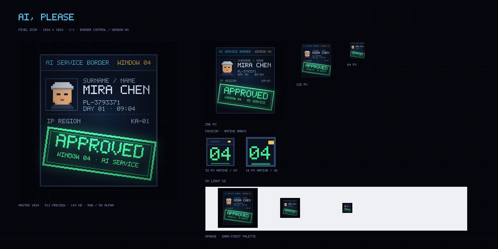
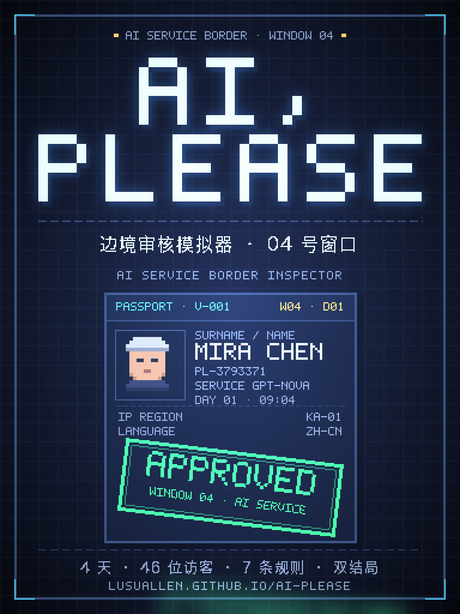

# AI, PLEASE · 像素图标与封面

> 图标 1024 × 1024 · 1:1 · RGB · 143 KB（上限 5 MB）
> 封面 1152 × 1536 · 3:4 · RGB · 283 KB（上限 10 MB）





## 概念

图标就是游戏的第一屏隐喻：**04 号窗口正在审的那本护照，被盖了一个绿色的 APPROVED 章**。

| 图标元素 | 对应的游戏语言 |
| --- | --- |
| 深蓝护照卡片 + 双线边框 | 游戏内 `CHECKPOINT · WINDOW 04` 面板（`.panel` 硬边框、零圆角） |
| 顶部 `AI SERVICE BORDER` / `WINDOW 04` | 主界面抬头与窗口编号（青色锚点 + 琥珀色编号） |
| 像素头像 | 访客护照照片（`PixelAvatar` 同款 16×16 像素人像） |
| `MIRA CHEN` / `PL-3793371` / `IP REGION KA-01` | 护照字段与第一关规则字段 |
| 倾斜的绿色 `APPROVED` 章 | 裁决章本身：`STAMP · APPROVE` 的绿色 + 辉光 + 8° 倾斜 |
| 细网格背景 / 扫描线 / 绿色辉光 | 舞台的 CRT 扫描线与霓虹光晕 |

一张图把「护照 → 核对 → 盖章」的闭环讲完，缩到 64 px 仍能读出：**深色证件 + 绿色印章**。

## 文件

| 文件 | 用途 |
| --- | --- |
| `ai-please-icon-1024.png` | 母版 · 应用商店 / 社交媒体 / 文档 |
| `ai-please-icon-512.png` | PWA / Android / 通用导出 |
| `ai-please-icon-256.png` | macOS / Windows 图标源 |
| `ai-please-icon-128.png` | 桌面快捷方式 / 站点图标 |
| `ai-please-icon-64.png` | 桌面图标 / 分享缩略图 |
| `favicon-32.png` / `favicon-16.png` | 小尺寸专用标记：深色证件框 + 绿色 `04`（窗口编号），16 px 仍可读 |
| `ai-please-icon.ico` | 16/32/48 用 `04` 小标记，64/128/256 用完整护照图（共 6 个尺寸） |
| `preview-contact-sheet.png` | 多尺寸 + 浅色 UI 可读性预览 |
| `ai-please-cover-1152x1536.png` | 3:4 封面母版（1152×1536） |
| `ai-please-cover-768x1024.png` | 3:4 封面小尺寸版 |
| `make-icon.py` | 生成脚本（Pillow，无外部素材、无网络） |

## 封面（3:4）

同一套视觉语言，按「海报」而不是「图标」重排：

- 标题 `AI,` / `PLEASE` 用 8× 像素字（5×7 点阵）直接排印，青色逗号、藏青硬阴影、冷白辉光；
- 中文副标 `边境审核模拟器 · 04 号窗口` 用 Hiragino Sans GB 在 15 px 渲染后二值化（1-bit），保留像素质感而不是平滑字体；
- 主体是一张 210×208 的护照卡：`PASSPORT · V-001`、像素头像、`MIRA CHEN`、`GPT-NOVA`、`IP REGION KA-01`，压一枚倾斜 7° 的绿色 `APPROVED` 章；
- 页脚是真实内容钩子：`4 天 · 46 位访客 · 7 条规则 · 双结局` + 线上地址；
- 外框、四角青色括号、CRT 扫描线与顶部冷光 / 底部紫光，全部沿用游戏舞台的调色板。

## 生成

逻辑画布 256 × 256，`NEAREST` ×4 放大到 1024；扫描线、辉光、晕影在 1024 层叠加，保证像素块边缘干净。

```bash
python3 docs/brand/make-icon.py
```

脚本一次产出图标全套 + 3:4 封面；封面逻辑画布 384×512，`NEAREST` ×3 到 1152×1536。

只依赖 Pillow（本机 DSH 运行时自带 12.3.0）与 macOS 自带 `Hiragino Sans GB`（仅用于中文二值化，缺字体时会报错，可换任意中文 TTF）。改配色/文字/章体尺寸只需改脚本顶部的调色板与 `build_stamp_layer()`。

小尺寸标记 `04` 由 `build_favicon(size)` 按 32 / 16 原生栅格直接绘制（不缩放、不糊），`.ico` 用脚本里的 `write_ico()` 以 PNG-in-ICO 方式逐尺寸写入，因此 16/32/48 是 `04` 标记、64 以上是完整护照图。

## 调色板

与 `src/styles/global.css` 的 CSS 变量一一对应，不引入新色：

| 变量 | 值 | 图标中的位置 |
| --- | --- | --- |
| `--bg` | `#05070d` | 背景 |
| `--panel` / `--panel-2` | `#0b1220` / `#101a2d` | 护照卡 / 抬头条 |
| `--line-2` | `#2f4468` | 卡片边框 |
| `--ink` | `#d5e2f2` | 姓名主标 |
| `--cyan` | `#4fd1ff` | `AI SERVICE BORDER`、角落高光 |
| `--amber` | `#f5c451` | `WINDOW 04` |
| `--green` | `#3ef08a` | APPROVED 章与辉光 |
| `--ink-dim` / `--ink-faint` | `#8698b3` / `#7c8ea9` | 护照副字段 |

## 接入建议（本次未改动站点源码）

站点目前没有 favicon / manifest。要接的话是纯加法，不碰游戏逻辑：

1. 把 `ai-please-icon.ico`、`ai-please-icon-128.png`、`ai-please-icon-512.png` 放进 `public/`（Vite 会原样拷进 `dist/`）；
2. `index.html` 的 `<head>` 加
   `<link rel="icon" href="/ai-please/favicon.ico" sizes="any">`
   `<link rel="icon" type="image/png" sizes="32x32" href="/ai-please/favicon-32.png">`
   `<link rel="apple-touch-icon" href="/ai-please/ai-please-icon-512.png">`；
3. 若要 PWA，再补 `manifest.webmanifest`（`icons` 用 512 / 256，`display: standalone`）；
4. 跑 `npm run verify:all` 复核产物预算（整套图标约 460 KB，按需只放 favicon 两件约 0.5 KB，远小于总量 260 KB 上限）。
